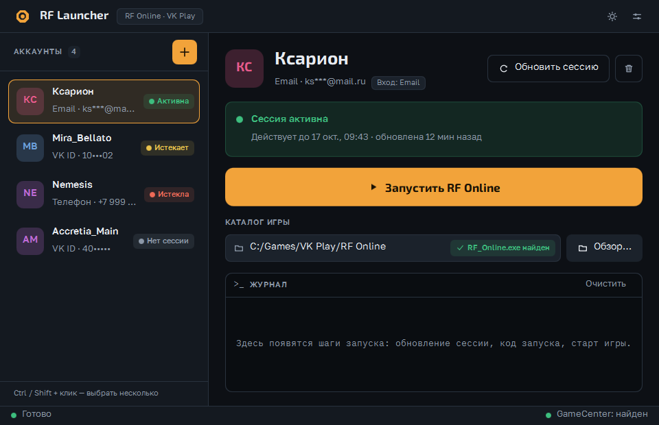

# RFVK Launcher

Альтернативный лаунчер RF Online (VK Play) для Windows x64. Хранит сессии нескольких аккаунтов и запускает игру под одним или сразу несколькими из них.

## Быстрый старт

1. Скачайте архив `RFVKLauncher-<версия>-win64.zip`, распакуйте его целиком и запустите `RFVKLauncher.exe`. [Релизы на GitHub](https://github.com/AkaRyuuno/RFVK-Launcher/releases)
2. В поле «Каталог игры» выберите папку с `RF_Online.exe`.
3. Войдите в нужный аккаунт в VK Play GameCenter. В лаунчере откройте «Добавить аккаунт» и нажмите «Импортировать из GameCenter». Повторите для остальных аккаунтов.
4. Выберите нужные аккаунты и нажмите «Запустить RF Online». Чтобы выбрать несколько аккаунтов, кликайте по ним с зажатым `Ctrl` или `Shift`.



## Возможности

- **Перенос аккаунтов.** Выделите аккаунты и выберите «Экспорт» в контекстном меню. На другом ПК откройте «Добавить аккаунт» → «Импортировать из файла…» и выберите сохранённый JSON. Файл может содержать токены сессий в открытом виде, поэтому храните его как пароль.
- **Автовход.** FG-пароль и персонаж задаются в карточке «Автовход». Список персонажей появляется после первого входа.
- **Прокси и слоты.** Можно назначить аккаунту прямое подключение, прокси SOCKS5 или HTTP CONNECT либо оставить автоматический выбор. Списки прокси по URL можно добавлять и проверять в лаунчере.
- **Улучшенный HUD.** Для этой функции положите `seirin.dll` рядом с `RFVKLauncher.exe` и включите «Улучшенный HUD в игре» в настройках. Библиотека распространяется отдельно.

## Сборка из исходников

Нужны Visual Studio 2022 или 2026 с компонентом MSVC x64/x86, CMake 3.21+, Ninja и Qt 6.5+ для MSVC x64. Ниже приведён пример с Qt 6.11.2 (`msvc2022_64`), который используется для релизных сборок.

В консоли разработчика x64 с Ninja в `PATH` укажите свой путь к Qt и выполните команды из корня репозитория.

```bat
cmake -S . -B out/build/release -G Ninja -DCMAKE_BUILD_TYPE=Release "-DCMAKE_PREFIX_PATH=C:/Qt/6.11.2/msvc2022_64"
cmake --build out/build/release
cmake --install out/build/release --prefix out/dist
```

Готовая поставка с библиотеками Qt находится в `out/dist`. CMake также собирает 32-битные библиотеки автовхода и прокси. Их можно отключить параметрами `-DRFVK_AUTOLOGIN=OFF` и `-DRFVK_PROXY=OFF` соответственно.
